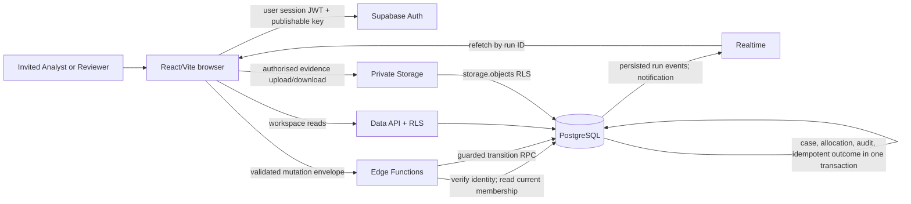

# Ola connected architecture contract (SCRUM-37)

Status: proposed implementation contract for SCRUM-38–53. Reviewed against the Ola prototype and the Jira specifications on 9 November 2026. It describes planned server behaviour, **not** behaviour already present in the local prototype. The current app uses synthetic arrays, a browser role selector and `localStorage`; it has no authenticated backend or durable audit store. See [README](../README.md), [investigation controls](../BANKING_RULE_CRITERIA.md), and the [implementation map](implementation-index.md).

## Decision and scope

Keep the existing React/Vite JSX and CSS interface. Use Supabase Auth for invite-only users, PostgreSQL for shared workspace records, Row Level Security (RLS) for scoped reads, private Storage for evidence and imported originals, Edge Functions for validated requests, and constrained PostgreSQL transactions for state changes. Persist run events and use Realtime as a notification path; refetch authoritative records after reconnect. Build the Vite frontend for Vercel only when the release task is authorised. Reconciliation is a deterministic rule engine and does not move funds or claim access to bank systems.

The current browser-only prototype is the baseline, not an alternate production authority. No browser role value, `localStorage` decision, `user_metadata`, client-supplied actor ID, or animation result can grant permission or commit a match. The backend migration is staged by [SCRUM-38–53](implementation-index.md); there is no automatic import of saved browser decisions.

## Trust and data boundaries

| Boundary | Contract |
| --- | --- |
| Browser → backend | Browser holds only `VITE_SUPABASE_URL` and `VITE_SUPABASE_PUBLISHABLE_KEY`. It sends a user session JWT in `Authorization` and the publishable key in `apikey`. A publishable key is not a user identity. No service/secret key or database password enters a Vite variable or client bundle. |
| Auth → membership | A verified user ID identifies the caller. Every protected mutation rereads the active `workspace_members` row from PostgreSQL; role changes or deactivation take effect without trusting stale UI state or editable metadata. An active member has exactly one `analyst` or `reviewer` role per workspace. |
| Data API → records | Enable RLS on every exposed business table and grant only scoped reads to current active members. A workspace filter in JavaScript is not sufficient. Ordinary users cannot directly write membership, policy, source, submission, decision, allocation or audit rows. Out-of-workspace IDs disclose no records. |
| Edge Function → transaction | The function validates identity, membership, request shape, ownership and policy; a constrained SQL routine locks current rows, rechecks essential rules, applies version/allocation changes, inserts audit and saves idempotent outcome together. A required audit failure rolls back the business change. Privileged database paths are narrowly granted and deny direct client execution. |
| Evidence → Storage | `originals` and `evidence` buckets are private. Storage policies independently check workspace/case access; paths are not permissions. Accepted originals and referenced evidence are immutable. A fresh membership check precedes a short-lived signed link (target five minutes). Storage and PostgreSQL are separate systems, so failed imports may leave an unreferenced object eligible for guarded cleanup. |
| Realtime → UI | Subscriptions report a possible change; persisted runs, stage events, cases and audit rows are refetched under the caller's RLS. Diagnostic events are provisional until a run completes. A failed run must not create active matches or matched dashboard totals. |

Use the supported Supabase user-JWT verification path selected and pinned by SCRUM-40. The current [Edge Function auth guide](https://supabase.com/docs/guides/functions/auth) distinguishes user JWTs from API keys, and the [RLS guide](https://supabase.com/docs/guides/database/postgres/row-level-security) covers table policies. Do not use a service-key client for ordinary workspace reads; it bypasses RLS. Review [private bucket access](https://supabase.com/docs/guides/storage/buckets/fundamentals) independently of table policies.

## IDs, money, time and policy

- Internal workspace, case, source, submission, decision, evidence, run and request IDs are UUIDs. `COL-1011` and `LED-5001` remain stable source/display identifiers, never permission tokens. Every business record is workspace-scoped.
- Store money as PostgreSQL `bigint` minor units. The absolute magnitude of each amount is at most `9007199254740991` minor units. Collections are positive; credit postings are nonnegative; reversal postings are negative; fees are nonnegative. Send `amountMinor` in read JSON as a base-10 integer **string** to avoid JavaScript precision loss. Accept create/import amounts only as decimal strings with no more than two fractional digits. Currency is `SGD` or `USD`; never add currencies together or infer FX.
- Input timestamps require an ISO 8601 offset and are normalised to UTC. Store event timestamps on the server. Display dates and times in `Asia/Singapore`; record UTC in exports. Time windows compare instants, not formatted local times.
- Workflow status is independent of matching category. The eight canonical status values and two roles are exported by [`shared/domain.js`](../shared/domain.js). SCRUM-38 owns the transition table. `verified` means human reconciliation approval; `auto_matched` means a separate rules-engine route.
- Code-controlled `policy_versions(version PK, settings jsonb, sha256)` is append-only. A trusted migration adds a version; `workspaces.active_rule_version` selects it. Ordinary members cannot create/edit versions or switch the active version. Shared JavaScript and SQL independently enforce primitive rules with parity fixtures. The demo policy keeps inclusive 30-minute posting/nearby windows and inclusive SGD/USD 10,000.00 human-verification thresholds; these are demo assumptions, not bank policy. An exact low-risk case auto-matches only when all rules pass, the ledger allocation is exclusive, and `needs_revalidation` is false. Hard duplicate, reversal, currency, unexplained amount, timing and policy blockers cannot be overridden by prose.

## API contract

`POST /functions/v1/case-action` receives `{workspaceId, caseId, action, expectedVersion, idempotencyKey, payload}`. IDs and `idempotencyKey` are UUIDs; `expectedVersion` is a positive integer. The server obtains actor, current role, time, case state and rule results independently. The action vocabulary is `claim`, `save_draft`, `add_evidence`, `submit`, `withdraw`, `approve`, `return`, `escalate`, `reopen`. `POST /functions/v1/create-collection` is the Analyst-only manual-source endpoint; `POST /functions/v1/reconcile` and `POST /functions/v1/import-source` have their own validated envelopes. See [permissions](permissions.md) for role and record scope. SCRUM-42 owns field-level schemas and [SCRUM-38](implementation-index.md) owns transition details.

Success is `{ "data": { ... }, "requestId": "uuid" }`. Failure is `{ "error": { "code": "STABLE_CODE", "message": "Safe message", "fieldErrors": { ... }, "currentVersion": 2 }, "requestId": "uuid" }`; optional fields are omitted when irrelevant. Use 400 for malformed input, 401 for absent/invalid identity, 403 for a known member without permission, 404 for absent or out-of-workspace resources, 409 for stale versions/allocation/idempotency conflicts, 422 for invalid business inputs and 500 for unexpected failures. A failure never reports an attempted action as committed. The same idempotency key with the same canonical request returns the saved outcome once; reuse with changed input returns 409.

Each important committed action records a durable `audit_events` row with server actor/time, event type, workspace/case target, request ID, case version and relevant run/submission/decision/import IDs, rule version and structured result. Human-readable summaries are derived from stable event codes. Source records, returned/withdrawn submissions and prior decisions remain historical. Audit rows are append-only to ordinary clients. This is an inspectable application trail, not a certified tamper-proof ledger. The coverage and export contract is completed in SCRUM-48; initial atomic audit writes belong in SCRUM-39/42.

## Environments and local workflow

| Environment | Data and access | Change boundary |
| --- | --- | --- |
| Local | Local Supabase stack, synthetic seed files, two invited test users. Browser `.env.local` contains only its URL and publishable key. | SCRUM-39 owns versioned migrations/seed; SCRUM-40 owns trusted account bootstrap. Discover the pinned CLI syntax with `--help` before using it. |
| Preview | Isolated backend and Vercel preview for a tested commit, with synthetic accounts and private buckets. | Must not share a database or credentials with the protected release target. SCRUM-52 records exact project references before any hosted mutation. |
| Demo/release | Separately identified backend, protected secrets and tested frontend artifact. | SCRUM-52 owns deployment, smoke checks, migration review, rollback and any authorised promotion. No bank integration or live customer records are implied. |

Local sequence: copy `.env.example` to ignored `.env.local`; install pinned lockfiles; start the local Supabase stack; apply reviewed migrations/seed; bootstrap two synthetic accounts via trusted tooling; run permission, policy, workflow and UI tests; build Vite. SCRUM-39's schema, synthetic seed and pinned Supabase CLI are now included; the React app still uses local prototype data and has no authenticated action API. See [database integration evidence](scrum39-integration.md) for the SQL tests and the full Supabase verification gate. Other CLI/package versions are selected by their owning tickets after checking installed versions, official help and changelog. The [Supabase changelog](https://supabase.com/changelog?types=breaking-change) is a required version check; its CLI v3 local-by-default change makes explicit target review material before hosted changes.

## Decision record and review triggers

**Chosen:** extend Ola incrementally with Supabase-backed authority. **Current alternative:** keep localStorage for the pitch only; it cannot meet shared identity, workspace isolation or durable audit requirements. **Other alternative:** build a custom Express/PostgreSQL server; it adds auth/session, storage and deployment work outside this team's current MVP scope without changing the required policy invariants. The Supabase design still requires careful RLS, transactions and integration testing; it is not a shortcut around those controls.

The main failure risks are permission drift across browser/API/SQL, stale evidence being approved, duplicate ledger allocation and a demo that mistakes provisional animation for saved state. Mitigate with one shared permission vocabulary, current-membership checks, database constraints/transactions, parity fixtures, two-user tests and refetch-after-reconnect. The FSDP Ola team owns this contract and should review it before SCRUM-38/39 implementation; revisit it at each dependency handoff and before the SCRUM-52 release decision. Reconsider the stack if the team cannot run the local stack or prove workspace isolation, if bounded reconciliation exceeds the Edge Function execution limits measured on representative synthetic loads, or if the release environment's data/control requirements differ from this synthetic MVP. SCRUM-51 supplies the integrated gate; SCRUM-52 owns release decisions.
