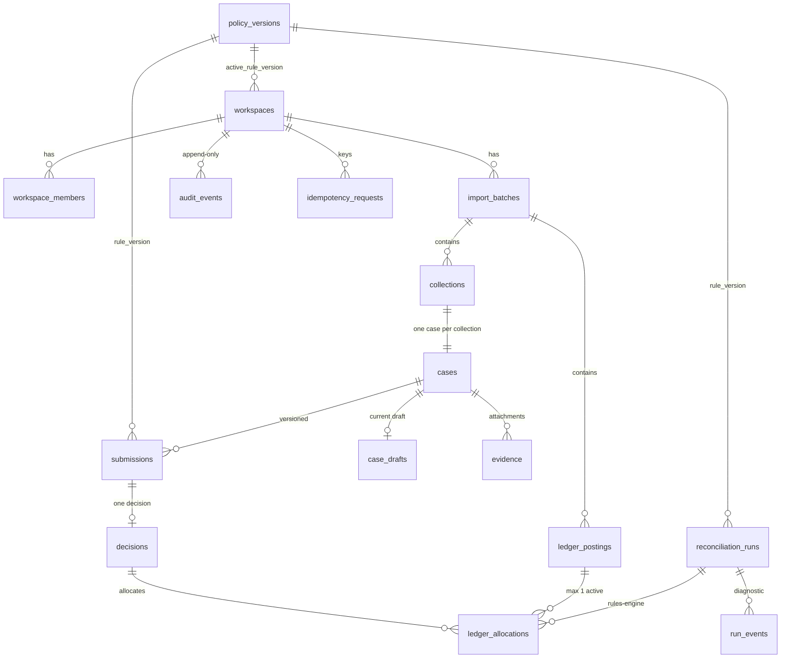

# Ola Database Model

Supabase PostgreSQL schema for Ola: immutable source records, workspace isolation, versioned submissions and
transactional control primitives. Baseline prototype commit `a89c2ed`; parent SCRUM-36; spec revision `263e66a869f9` (2026-11-06).
Browser `localStorage` is **not** migrated as trusted server data.

- Migrations: `supabase/migrations/` (7 files, applied in order)
- Seed: `supabase/seed.sql` — **generated** from `src/data.js` by `npm run db:seed:generate`
- Tests: `supabase/tests/database/{history,schema,rls,seed}.test.sql` (pgTAP, 268 assertions)
- Generated types: `src/db/database.types.ts` (`npm run db:types`)
- CLI: `supabase@3.0.0`, pinned exactly in `devDependencies` (commands below were taken from that version's `--help`)

| Migration | Contents |
|---|---|
| `20261109083027_foundation` | enums, `policy_versions` (+ `demo-1`), `workspaces`, `workspace_members`, `profiles` |
| `20261109083029_sources_and_cases` | `import_batches`, `collections`, `ledger_postings`, `cases`, `case_drafts`, `evidence`, `submissions`, `decisions` |
| `20261109083032_workflow_runs_audit` | `reconciliation_runs`, `run_events`, `ledger_allocations`, `audit_events`, `idempotency_requests` |
| `20261109083034_transaction_primitives` | immutability/integrity triggers, `app.*` transaction primitives |
| `20261109083036_security_rls_storage` | grants, RLS, membership helpers, read views, private storage buckets + policies |
| `20261109190000_foreign_key_indexes` | indexes for all 22 foreign-key relationships identified by Supabase Database Advisors |
| `20261109190001_align_project_contracts` | canonical workflow states, current policy version, same-case history references, exclusive allocation origins and attached-object reads |

## Schema diagram



Every child → parent reference inside a tenant is the **composite** `(workspace_id, id)` key, so a row can never point into
another workspace. `workspace_members` is also the target for every user reference (`created_by`, `reviewer_id`, …), so a user
reference is only valid for an actual member of the same workspace. Membership rows are never deleted (`active` is toggled).

## Key decisions

| Topic | Decision |
|---|---|
| IDs | UUIDs internally; `source_record_id` keeps `COL-…`/`LED-…`. Seed UUIDs are deterministic (UUIDv5). |
| Source dedupe | `unique(workspace_id, source_system, source_record_id)` on each source table. A changed payload under an existing ID **conflicts** (23505); it is never updated. Source-correction lineage is deferred. |
| Duplicate references | `ledger_postings.reference` is intentionally **not** unique; the `QR-241024-102` / `QR-241024-116` scenarios import as distinct source IDs. |
| Money | `bigint` minor units, magnitude ≤ 9007199254740991. `collections.amount_minor > 0`; credit `>= 0`; reversal `< 0`; `fee_minor >= 0`. Currency enum `SGD`/`USD`; `timestamptz` (UTC at rest). |
| Source hash | `source_hash` = SHA-256 of canonical JSON (fixed key order, UTC instant, amounts as minor-unit strings) — see `scripts/generate-seed.mjs`. The DB checks only its format. |
| Snapshot capture | `submissions.source_snapshot` is built by a `BEFORE INSERT` trigger from the case's collection and `proposed_ledger_id` (id, source id, hash). Caller-supplied keys cannot override the captured ones. `evidence_ids` holds attachment UUIDs only and may be empty. |
| Allocation | Partial unique indexes: one active (`released_at IS NULL`) allocation per `(workspace, ledger)` and per `(workspace, case)`. |
| Policy | `policy_versions` immutable; `sha256` is verified by a `CHECK` over `settings::text`. `SCRUM-9-v1` mirrors current `RULE_SETTINGS` in `src/rules.js`. Historical `demo-1` remains unchanged; existing workspaces retain their active version, while fresh seed selects `SCRUM-9-v1`. |
| Pre-commit run events | `run_events` are diagnostic/provisional. Only a `completed` run (terminal) has applied outcomes. |

### Immutability (enforced for everyone, including `service_role` and the table owner)

| Behaviour | Tables |
|---|---|
| insert-only (UPDATE/DELETE/TRUNCATE → `42501`) | `policy_versions`, `import_batches`, `collections`, `ledger_postings`, `decisions`, `audit_events`, `run_events` |
| never deleted; update limited | `submissions` (only `status`), `ledger_allocations` (only `released_at`, once), `reconciliation_runs` (terminal once completed/failed; identity + snapshot fixed), `cases` (identity fixed; `version` +1 only), `evidence` (no update; delete refused while referenced), `workspaces`, `workspace_members`, `profiles` |

`audit_events.occurred_at` is stamped by a trigger (`clock_timestamp()`); callers cannot backdate. `TRUNCATE` on a table that is the
target of a foreign key is refused by PostgreSQL itself (`0A000`) before triggers run.

## Access model

- `anon`: no privileges on application tables, views or `app` routines. Supabase grants `SELECT` on `storage.objects`, but storage RLS exposes zero objects to `anon` (verified against the local stack).
- `authenticated`: **SELECT only**, via RLS, for rows whose `workspace_id` is in `app.member_workspace_ids()` (active memberships). No INSERT/UPDATE/DELETE grant and no write policy anywhere, so membership, policy settings, active rule version, workflow, decisions, allocations, audit, imports and evidence metadata are unreachable by direct table access. `idempotency_requests` has no client privileges (and an explicit deny-all policy).
- `service_role`: bypasses RLS but not the triggers above.
- Roles (`analyst`/`reviewer`) currently differ only for storage uploads (analyst-only evidence upload) and via `app.has_workspace_role()`, which SCRUM-42 routines should use for action authorisation. Both roles may read the whole workspace.
- `profiles` holds display data only and is never used for authorisation.

### Privileged routines

SQL routines are `SECURITY INVOKER` with `search_path = ''`, except two read-only `SECURITY DEFINER` helpers that RLS needs to avoid
recursing into `workspace_members`' own policy: `app.member_workspace_ids()` and `app.has_workspace_role(uuid, member_role[])`.
Controls: fixed `search_path`, no caller-supplied user (identity is `auth.uid()`), `EXECUTE` only for `authenticated`/`service_role`.
The `app` schema is not in the PostgREST exposed schemas. **Routines SCRUM-42 adds that must write on behalf of a user will need
`SECURITY DEFINER`**; they must add explicit membership/role checks, a fixed `search_path`, and narrow `EXECUTE`, and call the primitives below.

### Storage

Private buckets `originals` (text/csv) and `evidence`. Paths: `<workspaceUUID>/<importUUID>/original.csv` (enforced on
`import_batches.file_object_path`) and `<workspaceUUID>/<caseUUID>/<objectUUID>` (enforced on `evidence.object_path`; the object UUID is `evidence.id`).
Clients can read objects attached to their workspace's import/evidence metadata; same-workspace orphan objects are hidden. Analysts can **insert** evidence objects for a case in their workspace; nobody on the client
side has UPDATE/DELETE, so objects are never overwritten or removed. Originals are written by the server only.
Storage and PostgreSQL are not one transaction: archive the CSV after full validation and **before** the business-row commit; a failed
commit can leave an unattached object that authorised cleanup (service role) removes.

## Transaction primitives (`app` schema, `service_role` only)

| Function | Purpose |
|---|---|
| `lock_case(ws, case, expected_version)` | `SELECT … FOR UPDATE`; `OL404` if missing, `OL409` on version mismatch |
| `bump_case_version(ws, case)` | advance `cases.version` by one (trigger rejects any other jump) |
| `idempotency_begin(ws, user, action, key, resource, payload_hash)` | returns `(replayed, status, result_json)`; `OL422` if the key is reused with a different payload/resource |
| `idempotency_complete(ws, user, action, key, status, result)` | record the outcome; a deferred constraint trigger refuses to commit a row still `pending` |
| `append_audit(...)` | append-only audit insert; adds `schemaVersion` |
| `allocate_ledger(ws, case, ledger, decision, run)` / `release_allocation(ws, id)` | claim/release; the partial unique indexes arbitrate, conflicts raise `OL409` and abort the caller's transaction (no partial decision) |

SQLSTATEs: `OL404` not found · `OL409` version/allocation conflict · `OL422` idempotency key misuse · `42501` denied/append-only.

## Read-model contract

Views (all `security_invoker`, so the caller's RLS applies): `collection_read`, `ledger_posting_read`, `submission_read`,
`collection_totals_read`. `amount_minor`, `fee_minor`, `record_count` and `total_minor` are returned as **integer strings**;
`submission_read.submitted_at` aliases `submissions.created_at` (DTO `submittedAt`). Create/import amounts are accepted as decimal
strings with at most two decimals and converted to minor units by the import/action layer (not by the database).
Generated TypeScript types: `src/db/database.types.ts`.

## Provisional / assumed (please confirm)

1. **Case state vocabulary** now matches `shared/domain.js`; categories include the engine's `invalid` evidence outcome. The compatibility migration converts legacy `new`/`needs_review` to `open`, `submitted` to `awaiting_review`, and `reviewed_match` to `verified`, incrementing case versions and recording each conversion. SCRUM-38 still owns transition rules; the `submission_status` and `decision_outcome` enums remain foundation assumptions.
2. `import_batches.origin` (`csv_import|manual|seed`) is an **added column**: the spec makes `file_object_path` required for user CSV imports but nullable for seed/manual, which needs a discriminator. `import_batches.status` is `accepted|rejected`.
3. `unique(workspace_id, case_id, case_version)` on `submissions` (one submission per case version) and `unique(submission_id)` on `decisions` (one decision per submission) interpret “versioned submissions”.
4. `ledger_postings.counterparty/channel` are nullable (ledger exports do not carry them); on `collections` they are required.
5. `cases.assigned_analyst_id` is checked to be a workspace member but **not** to be an analyst; SCRUM-42 should validate the role.
6. `policy_versions.settings` keeps `RULE_SETTINGS` shape (major-unit thresholds) rather than converting to minor units.

## Seed and local bootstrap

Prerequisites: Node 20.19+/22.12+, Docker (for the local stack), `npm ci`.

```bash
npm ci
npx supabase start          # local stack (needs Docker)
npm run db:reset            # = supabase db reset: drops, re-applies migrations, loads supabase/seed.sql
npm run db:test             # = supabase test db: pgTAP (schema, rls, seed)
npm run db:advisors         # = supabase db advisors --type all --level info
npm run db:types            # regenerate src/db/database.types.ts
npm run db:seed:generate    # regenerate supabase/seed.sql + seed.test.sql from src/data.js
```

**Seed/reset behaviour.** `db reset` always starts from an empty database, so seeding is deterministic and repeatable; `seed.sql` is
not idempotent and is not meant to be re-run on a populated database (it will fail on primary keys — reset instead). Because audit
history and source rows are immutable by design, the *only* supported way to clear data is a reset (or dropping the database).
The seed creates workspace **Ola Demo**, two **placeholder** auth identities (`bootstrap-analyst@ola.local`, `bootstrap-reviewer@ola.local`;
no password — SCRUM-40 replaces them with invited users), 24 collections, 24 ledger postings in the initial batch, `LED-5009` in a
separate *later* batch, 24 cases (`workflow_status='open'`, `creator_id` null = trusted system creation) and 3 system audit events.
The later batch is seeded but **unprocessed**: no run references it and no case or allocation points at it. Seeded batches have
`origin='seed'` and `file_object_path` NULL; `file_sha256` is the hash of the matching file in `public/mock-data/`.

## Verification

Run `npm run db:reset && npm run db:test && npm run db:advisors` on a machine with Docker. Where Docker is unavailable,
`scripts/verify-plain-postgres.sh` replays migrations + seed + the same pgTAP files on a throw-away PostgreSQL cluster with a small Supabase shim
(`scripts/supabase-shim.sql`). On Windows without Docker/PostgreSQL, `npm run db:verify:embedded` runs them on disposable PGlite PostgreSQL 18.6, verifies the legacy upgrade, and compares roles/statuses/policy to shared JavaScript contracts. These fallbacks do not exercise real Supabase services or concurrent sessions. Current output is [database-embedded-output.txt](evidence/database-embedded-output.txt); see [integration evidence and limitations](scrum39-integration.md).

### Security advisor review

The table below and `database-advisors-raw.json` are the teammate's captured advisor results for the six upstream migrations. Advisors have not been rerun on the integrated seven-migration schema because Docker is unavailable on this machine. The integration received a separate source review and SQL regression tests.

| Finding | Resolution |
|---|---|
| Security: none attributable to this schema | RLS on all 17 application tables; no `SECURITY DEFINER` view; every definer routine pins `search_path`. Anonymous application-table access is denied; storage RLS exposes zero objects to `anon`. Verified against the local stack and by pgTAP (`schema.test.sql`). |
| `extension_in_public` (pgTAP) | Only on the scratch database used here (pgTAP installed in `public`); the Supabase local stack installs it in `extensions`. Not part of the migrations. |
| Performance INFO `unindexed_foreign_keys` | Resolved. Added 22 supporting indexes in `20261109190000_foreign_key_indexes.sql`; no unindexed foreign-key findings remain. |
| Performance INFO `unused_index` | 25 INFO findings on the freshly reset, lightly seeded database. Expected before real application traffic; re-check index usage once representative traffic exists. No WARN or ERROR findings. |

## Data dictionary (generated from the migrated schema)

#### `audit_events`

| Column | Type | Null | Default |
|---|---|---|---|
| `id` | uuid | no | `gen_random_uuid()` |
| `workspace_id` | uuid | no |  |
| `case_id` | uuid | yes |  |
| `event_type` | text | no |  |
| `actor_kind` | actor_kind | no |  |
| `actor_user_id` | uuid | yes |  |
| `occurred_at` | timestamptz | no | `clock_timestamp()` |
| `request_id` | text | yes |  |
| `run_id` | uuid | yes |  |
| `submission_id` | uuid | yes |  |
| `decision_id` | uuid | yes |  |
| `import_batch_id` | uuid | yes |  |
| `case_version` | int4 | yes |  |
| `payload` | jsonb | no |  |

#### `case_drafts`

| Column | Type | Null | Default |
|---|---|---|---|
| `case_id` | uuid | no |  |
| `workspace_id` | uuid | no |  |
| `author_id` | uuid | no |  |
| `proposed_ledger_id` | uuid | yes |  |
| `findings` | text | no | `''::text` |
| `evidence_ids` | _uuid | no | `'{}'::uuid[]` |
| `updated_at` | timestamptz | no | `now()` |
| `version` | int4 | no | `1` |

#### `cases`

| Column | Type | Null | Default |
|---|---|---|---|
| `id` | uuid | no | `gen_random_uuid()` |
| `workspace_id` | uuid | no |  |
| `collection_id` | uuid | no |  |
| `category` | text | yes |  |
| `workflow_status` | text | no | `'open'::text` |
| `assigned_analyst_id` | uuid | yes |  |
| `creator_id` | uuid | yes |  |
| `version` | int4 | no | `1` |
| `queue_entered_at` | timestamptz | yes |  |
| `last_submission_id` | uuid | yes |  |
| `needs_revalidation` | bool | no | `false` |
| `created_at` | timestamptz | no | `now()` |

#### `collections`

| Column | Type | Null | Default |
|---|---|---|---|
| `id` | uuid | no | `gen_random_uuid()` |
| `workspace_id` | uuid | no |  |
| `import_batch_id` | uuid | no |  |
| `source_system` | text | no |  |
| `source_record_id` | text | no |  |
| `reference` | text | no |  |
| `counterparty` | text | no |  |
| `amount_minor` | int8 | no |  |
| `currency` | currency_code | no |  |
| `recorded_at` | timestamptz | no |  |
| `channel` | text | no |  |
| `created_by` | uuid | yes |  |
| `source_hash` | text | no |  |
| `raw_payload` | jsonb | no |  |

#### `decisions`

| Column | Type | Null | Default |
|---|---|---|---|
| `id` | uuid | no | `gen_random_uuid()` |
| `workspace_id` | uuid | no |  |
| `case_id` | uuid | no |  |
| `submission_id` | uuid | no |  |
| `reviewer_id` | uuid | no |  |
| `outcome` | decision_outcome | no |  |
| `reason` | text | no |  |
| `verified_large_amount` | bool | no | `false` |
| `snapshot` | jsonb | no |  |
| `created_at` | timestamptz | no | `now()` |

#### `evidence`

| Column | Type | Null | Default |
|---|---|---|---|
| `id` | uuid | no | `gen_random_uuid()` |
| `workspace_id` | uuid | no |  |
| `case_id` | uuid | no |  |
| `object_path` | text | no |  |
| `sha256` | text | no |  |
| `content_type` | text | no |  |
| `size_bytes` | int8 | no |  |
| `uploaded_by` | uuid | no |  |
| `created_at` | timestamptz | no | `now()` |

#### `idempotency_requests`

| Column | Type | Null | Default |
|---|---|---|---|
| `workspace_id` | uuid | no |  |
| `user_id` | uuid | no |  |
| `action` | text | no |  |
| `key` | text | no |  |
| `resource_id` | uuid | no |  |
| `payload_hash` | text | no |  |
| `status` | idempotency_status | no | `'pending'::idempotency_status` |
| `result_json` | jsonb | yes |  |
| `created_at` | timestamptz | no | `now()` |

#### `import_batches`

| Column | Type | Null | Default |
|---|---|---|---|
| `id` | uuid | no | `gen_random_uuid()` |
| `workspace_id` | uuid | no |  |
| `source_system` | text | no |  |
| `origin` | import_origin | no |  |
| `file_sha256` | text | yes |  |
| `file_object_path` | text | yes |  |
| `kind` | import_kind | no |  |
| `status` | import_status | no | `'accepted'::import_status` |
| `created_by` | uuid | yes |  |
| `created_at` | timestamptz | no | `now()` |
| `error_summary` | text | yes |  |

#### `ledger_allocations`

| Column | Type | Null | Default |
|---|---|---|---|
| `id` | uuid | no | `gen_random_uuid()` |
| `workspace_id` | uuid | no |  |
| `case_id` | uuid | no |  |
| `ledger_id` | uuid | no |  |
| `decision_id` | uuid | yes |  |
| `run_id` | uuid | yes |  |
| `allocated_at` | timestamptz | no | `now()` |
| `released_at` | timestamptz | yes |  |

#### `ledger_postings`

| Column | Type | Null | Default |
|---|---|---|---|
| `id` | uuid | no | `gen_random_uuid()` |
| `workspace_id` | uuid | no |  |
| `import_batch_id` | uuid | no |  |
| `source_system` | text | no |  |
| `source_record_id` | text | no |  |
| `reference` | text | no |  |
| `counterparty` | text | yes |  |
| `amount_minor` | int8 | no |  |
| `currency` | currency_code | no |  |
| `recorded_at` | timestamptz | no |  |
| `channel` | text | yes |  |
| `created_by` | uuid | yes |  |
| `source_hash` | text | no |  |
| `raw_payload` | jsonb | no |  |
| `posting_type` | posting_type | no |  |
| `fee_minor` | int8 | no | `0` |

#### `policy_versions`

| Column | Type | Null | Default |
|---|---|---|---|
| `version` | text | no |  |
| `settings` | jsonb | no |  |
| `sha256` | text | no |  |

#### `profiles`

| Column | Type | Null | Default |
|---|---|---|---|
| `user_id` | uuid | no |  |
| `display_name` | text | no |  |
| `created_at` | timestamptz | no | `now()` |

#### `reconciliation_runs`

| Column | Type | Null | Default |
|---|---|---|---|
| `id` | uuid | no | `gen_random_uuid()` |
| `workspace_id` | uuid | no |  |
| `actor_id` | uuid | yes |  |
| `rule_version` | text | no |  |
| `status` | run_status | no | `'queued'::run_status` |
| `input_snapshot` | jsonb | no | `'{}'::jsonb` |
| `error_code` | text | yes |  |
| `started_at` | timestamptz | yes |  |
| `completed_at` | timestamptz | yes |  |
| `created_at` | timestamptz | no | `now()` |

#### `run_events`

| Column | Type | Null | Default |
|---|---|---|---|
| `id` | uuid | no | `gen_random_uuid()` |
| `workspace_id` | uuid | no |  |
| `run_id` | uuid | no |  |
| `sequence` | int4 | no |  |
| `case_id` | uuid | yes |  |
| `stage` | text | no |  |
| `payload` | jsonb | no | `'{}'::jsonb` |
| `created_at` | timestamptz | no | `now()` |

#### `submissions`

| Column | Type | Null | Default |
|---|---|---|---|
| `id` | uuid | no | `gen_random_uuid()` |
| `workspace_id` | uuid | no |  |
| `case_id` | uuid | no |  |
| `submitted_by` | uuid | no |  |
| `case_version` | int4 | no |  |
| `rule_version` | text | no |  |
| `proposed_ledger_id` | uuid | yes |  |
| `findings` | text | no | `''::text` |
| `source_snapshot` | jsonb | no | `'{}'::jsonb` |
| `evidence_ids` | _uuid | no | `'{}'::uuid[]` |
| `status` | submission_status | no | `'submitted'::submission_status` |
| `created_at` | timestamptz | no | `now()` |

#### `workspace_members`

| Column | Type | Null | Default |
|---|---|---|---|
| `workspace_id` | uuid | no |  |
| `user_id` | uuid | no |  |
| `role` | member_role | no |  |
| `active` | bool | no | `true` |
| `created_at` | timestamptz | no | `now()` |

#### `workspaces`

| Column | Type | Null | Default |
|---|---|---|---|
| `id` | uuid | no | `gen_random_uuid()` |
| `name` | text | no |  |
| `active_rule_version` | text | no |  |
| `created_at` | timestamptz | no | `now()` |


